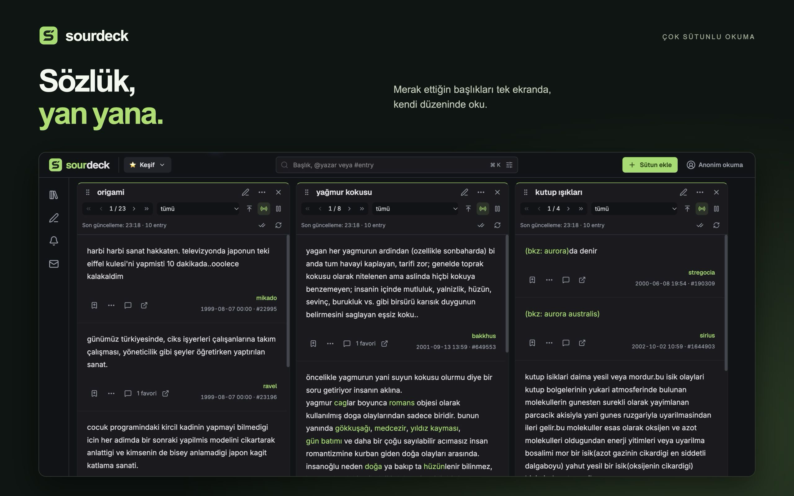
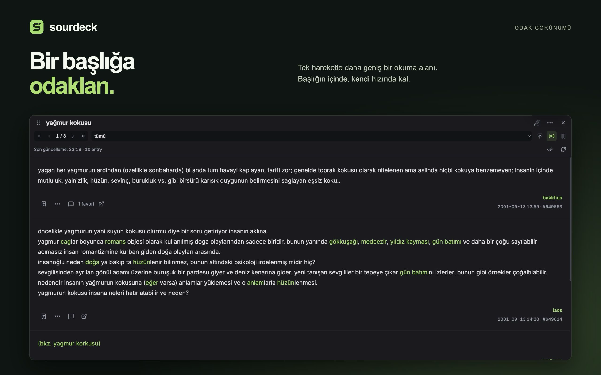
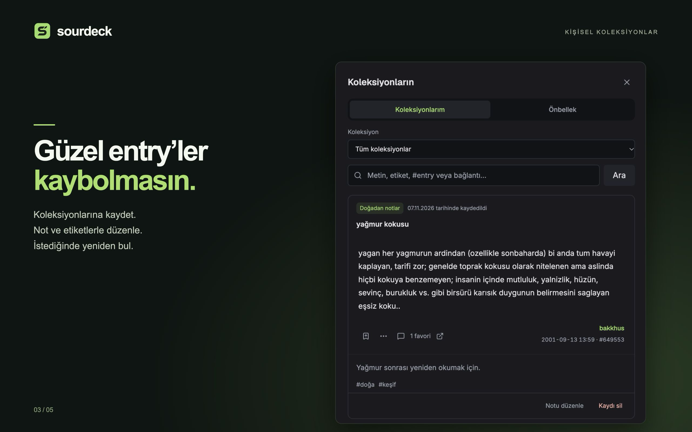
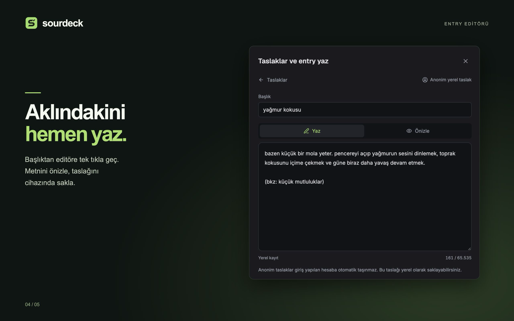
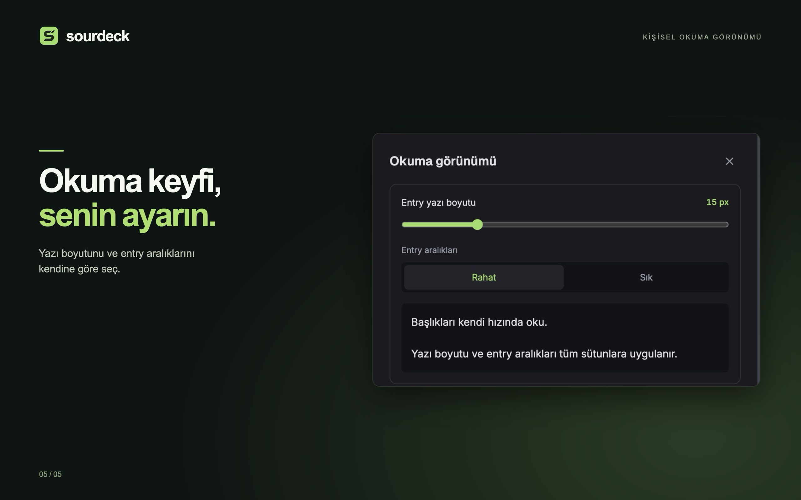

  

<h1 align="center">SourDeck</h1>

An independent desktop app for reading and following Ekşi Sözlük, side by side.

  <strong>English</strong> · <a href="README.tr.md">Türkçe</a>
   
  <a href="#features">Features</a> · <a href="#gallery">Gallery</a> · <a href="#technology">Technology</a> · <a href="SUPPORT.md">Support</a> · <a href="PRIVACY.md">Privacy</a>

<strong>macOS & Windows · Free</strong>

SourDeck turns Ekşi Sözlük into a personal reading workspace. Keep several topics open in independent columns, follow new entries as they arrive, save the ones you want to revisit, and write without losing your place. Read public content without signing in, or connect your Ekşi Sözlük accounts for account features.

> **Your reading setup and personal records stay on your device.** Workspaces, collections, notes, tags, and local drafts are stored locally; SourDeck does not automatically upload them to a central server. Reading online content and performing the account actions you choose involves communicating directly with Ekşi Sözlük.

## Download

  
  &nbsp;
  

## Gallery

### Independent columns, side by side

Follow several topics on one screen. Scroll, turn pages, and control live following independently in each column; reorder, expand, or send columns to another workspace.

<table>
  <tr>
    <td width="50%"> <strong>Room to focus</strong> Give one topic more space without closing the others.</td>
    <td width="50%"> <strong>Keep what matters</strong> Build collections with personal notes and tags.</td>
  </tr>
  <tr>
    <td> <strong>Write in context</strong> Open the editor from a topic and keep your draft locally.</td>
    <td> <strong>Make reading yours</strong> Adjust text size and spacing to suit your reading habits.</td>
  </tr>
</table>

The gallery uses our Turkish Mac App Store artwork, made from the running macOS app. Click an image to see it at full size.

## Features

### 01 — Read several topics at once

- **Independent columns:** open topics side by side, each with its own scroll position, pagination, filters, and live-follow controls.
- **Find your next read:** search topics and authors, open a topic link or entry number, and use supported today and şükela filters.
- **A horizontal deck:** move across your topics instead of squeezing every column into the window. Resize, reorder, pin, duplicate, or close columns as needed.
- **Focus mode:** expand one column for a longer read, then return to your previous layout.
- **Stay in context:** preview topic references and entry links in a side panel, then turn a preview into a permanent column when you want to keep it.
- **Predictable navigation:** opening a topic already present in your current workspace brings that column into view. New columns opened from another column appear beside it.
- **Reading continuity:** keep your place and read marker, and reopen the last closed column with a keyboard shortcut.

### 02 — Follow the conversation

- **Gündem, Bugün, and DEBE columns:** keep the agenda, today's topics, and yesterday's most liked entries alongside the topics you read. These discovery columns refresh automatically.
- **Live topic feeds:** follow new entries at the top of a column, or pause updates while you read older content.
- **Combined columns:** bring multiple topics into one chronological feed, with the source topic shown on each entry.
- **Since your last visit:** see increases in a topic's Gündem count compared with the last time you opened it from the agenda.
- **Hide for today:** dismiss an agenda topic directly from the list and undo the last dismissal if needed.
- **Clear refresh state:** see when a column last updated and use its refresh, pause, and live-follow controls.

Live following and local alerts work while SourDeck is running and the relevant sources are being followed. Online content depends on connectivity and Ekşi Sözlük service availability.

### 03 — Organize your own workspace

- **Named workspaces:** separate everyday reading, technology, sports, or any other interest into distinct layouts.
- **Personal details:** choose workspace icons and column colors, and give columns custom titles.
- **Quick switching:** use the workspace dropdown to change layouts while preserving each workspace's column state.
- **Move and reuse:** send a topic to another workspace, reorder workspaces, or duplicate a workspace or column.
- **Restore your setup:** return to your saved layout and last active workspace when you reopen the app.

### 04 — Keep useful entries close

- **Local collections:** save an entry snapshot and its source without adding it to your Ekşi Sözlük favorites.
- **Notes and tags:** add your own context, organize saved entries, and find them again later.
- **Offline search:** search your locally saved collection text. Cached content has a separate search and retention scope.
- **Personal author labels:** add local labels and aliases while keeping the author's real nickname visible.
- **Share cards:** prepare an entry image with its topic, author, date, and source, then save or copy it yourself.

Saved entries are snapshots, not a promise that the original entry will remain unchanged or available. Linked images and external pages are not a complete offline archive.

### 05 — Write without leaving the topic

- **A composer in the column header:** start writing directly from a topic with the title already filled in.
- **Local drafts:** create drafts, save automatically on your device, and return to them later from the drafts panel.
- **Preview before publishing:** check the local rendering of paragraphs, topic references, and links before you send an entry.
- **Workspace context:** keep drafts associated with the workspace you were writing in and filter the draft list by workspace.
- **Account actions:** publish entries, edit or delete your own entries, and use supported comments, favorites, and voting actions when signed in.
- **Account drafts:** explicitly retrieve and associate a supported Ekşi account draft with a local draft. Local autosave does not publish or send a draft to Ekşi Sözlük.

### 06 — Read anonymously or use your accounts

- **No account required for public reading:** browse public topics and entries in anonymous mode.
- **Multiple saved accounts:** switch between accounts without signing the others out. Adding a new account selects it automatically; restarting restores the last selected account or anonymous mode.
- **Separate personal data:** collections, drafts, reading state, and account content follow the selected account. Workspace layouts are shared on the device.
- **Messages and notifications:** access account conversations, supported message archive actions, and Ekşi Sözlük notifications.
- **Profiles and relationships:** view author profiles and entry lists, follow topics or authors, and use supported mute, block, and account preference controls.

Account actions require a valid Ekşi Sözlük account and the permissions available to that account. Availability also depends on the underlying service.

### 07 — Control what gets your attention

- **Column filters:** hide words or authors and highlight phrases within a specific column.
- **Smart alerts:** enable keyword or topic-activity rules for the sources you follow.
- **Quiet hours:** choose when desktop notifications should stay silent while the local notification list continues to update.
- **Comfortable reading:** adjust entry text size and choose compact or comfortable spacing.
- **Connection details:** inspect the shared request queue, connection state, rate-limit waits, and memory information in a dedicated panel.

Local display filters and author labels do not change an Ekşi Sözlük profile or its account-level block settings.

### 08 — Take your setup with you

- **Selective export:** choose workspaces and collections, with options for filters and reading preferences.
- **Import preview:** review an import before merging it into the app.
- **Keep your annotations:** collection exports include personal notes and tags.
- **Separate sign-in:** passwords, session tokens, encryption keys, and private messages are excluded from transfer files. Sign in again on the other device.

## Keyboard shortcuts

| Action | macOS | Windows |
| --- | --- | --- |
| Open the topic, author, or entry field | `⌘ K` | `Ctrl K` |
| Search topics and authors | `⌘ Shift F` | `Ctrl Shift F` |
| Start a draft in the current workspace | `⌘ N` | `Ctrl N` |
| Reopen the last closed column | `⌘ Shift T` | `Ctrl Shift T` |
| Move between columns | `Option ← / →` | `Alt ← / →` |
| Toggle focus mode for the keyboard-focused column | `F` | `F` |

## Technology

SourDeck is built as a desktop application with local services, rather than a browser frontend backed by a SourDeck server. Electron's main process coordinates API access, sessions, storage, and feeds; the React renderer communicates through a restricted preload bridge.

| Area | Technology | What it does |
| --- | --- | --- |
| Desktop runtime | **Electron** | Hosts the desktop window, native integrations, and local services on macOS and Windows. |
| Application code | **TypeScript + React** | Provides typed application contracts and a component-based reading interface. |
| Interface | **Tailwind CSS + Radix UI Primitives** | Supplies shared styling tokens and interaction primitives for dialogs, menus, tabs, and tooltips. |
| Icons and typography | **Lucide, Inter, Geist** | Keeps controls and text visually consistent. |
| Server-state cache | **TanStack Query** | Coordinates asynchronous queries, caching, invalidation, and refreshes. |
| Long lists | **TanStack Virtual** | Renders visible list content without mounting every entry at once. |
| Drag and drop | **dnd-kit** | Supports column and workspace reordering. |
| State machines | **XState** | Models session, connection, and live-feed lifecycles explicitly. |
| Data validation | **Zod** | Validates data at API, IPC, storage, and import boundaries. |
| Local persistence | **SQLite + better-sqlite3 + Drizzle ORM** | Stores layouts, personal records, drafts, and cached content; Drizzle Kit manages schema migrations. |
| Local search | **SQLite FTS5** | Provides full-text search for locally indexed content. |
| Request scheduling | **p-queue** | Coordinates shared request limits and priority handling. |
| Session encryption | **Node.js crypto · AES-256-GCM** | Encrypts saved sessions with a separate random key file on the same device. |
| Development and packaging | **Bun, Vite, electron-vite, electron-builder** | Manage workspaces, build the app, and produce store packages. The shipped app uses Electron's runtime. |
| Source quality | **Biome, TypeScript, dependency-cruiser, Secretlint** | Check formatting, types, module boundaries, and known secret patterns during development. |

## Data and privacy

- **No central SourDeck backend:** the app communicates directly with Ekşi Sözlük for online content and account operations.
- **Local personal records:** layouts, collections, annotations, and drafts live on your device. File export is available; automatic cloud sync is not provided.
- **Encrypted saved sessions:** session encryption does not encrypt the entire local database. Someone with access to both the session files and their local key may be able to use the session.
- **No advertising or usage analytics SDKs in the current app.** Store and operating-system services have their own data practices.
- **Online requests still leave your device:** anonymous mode means reading without a signed-in account, not network anonymity.

Read the [privacy policy](PRIVACY.md) for details.

## Support and project information

- [Support and frequently asked questions](SUPPORT.md)
- [Report an issue or suggest a feature](https://github.com/BurakVeziran/sourdeck/issues)
- [Privacy policy](PRIVACY.md)

This repository contains product information, screenshots, and support documents. It does not contain the application's source code. Please keep credentials, session files, private messages, and personal database exports out of public issues.

SourDeck is an independent app and is not affiliated with, endorsed by, or the official app of Ekşi Sözlük. The Ekşi Sözlük name and content belong to their respective rights holders.
