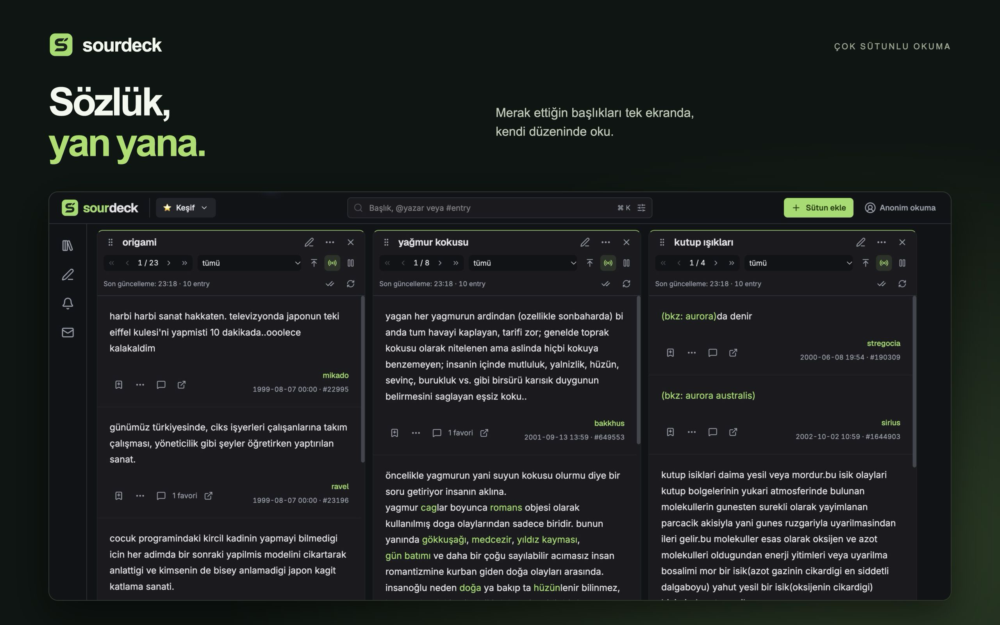
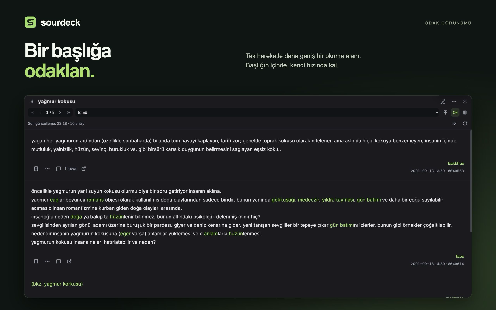
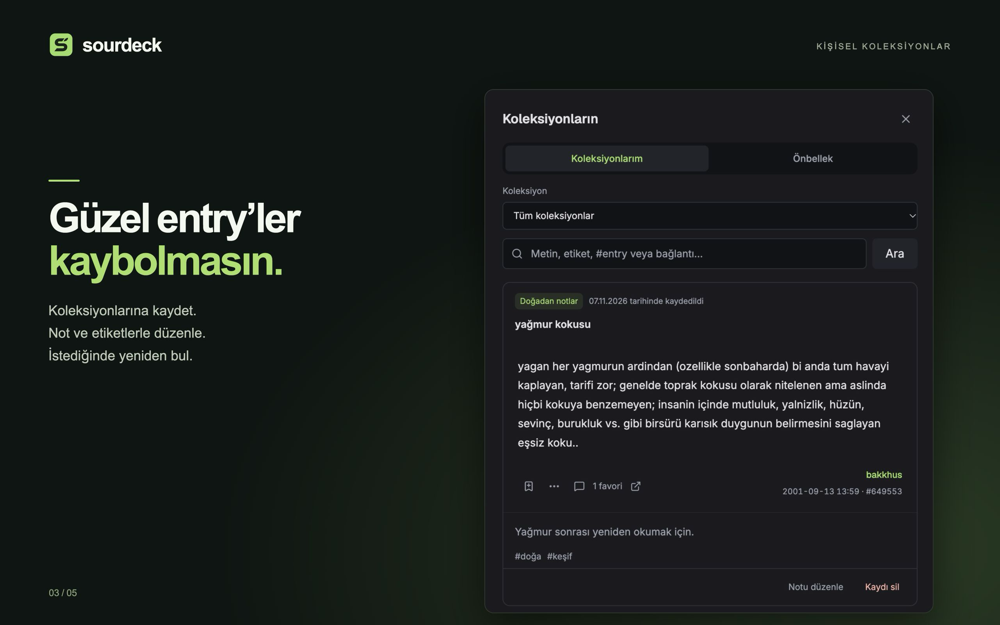
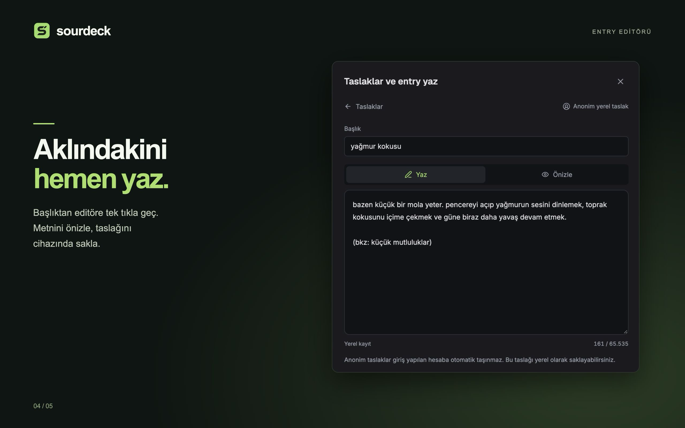
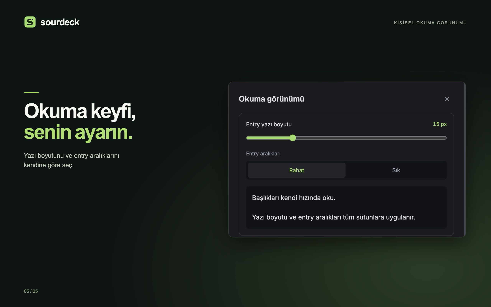

  

<h1 align="center">SourDeck</h1>

Ekşi Sözlük’ü yan yana okumak ve takip etmek için bağımsız bir masaüstü uygulaması.

  <a href="README.md">English</a> · <strong>Türkçe</strong>
   
  <a href="#özellikler">Özellikler</a> · <a href="#galeri">Galeri</a> · <a href="#teknolojiler">Teknolojiler</a> · <a href="SUPPORT.md">Destek</a> · <a href="PRIVACY.md">Gizlilik</a>

<strong>macOS ve Windows · Ücretsiz</strong>

SourDeck, Ekşi Sözlük’ü kişisel bir okuma alanına dönüştürür. Birden fazla başlığı bağımsız sütunlarda açık tut, yeni entry’leri geldikçe takip et, dönüp okumak istediklerini kaydet ve kaldığın yeri kaybetmeden yaz. Herkese açık içerikleri giriş yapmadan oku veya hesap özellikleri için Ekşi Sözlük hesaplarını ekle.

> **Okuma düzenin ve kişisel kayıtların cihazında kalır.** Çalışma alanların, koleksiyonların, notların, etiketlerin ve yerel taslakların cihazında saklanır; SourDeck bunları merkezi bir sunucuya otomatik yüklemez. İçerik okuma ve seçtiğin çevrimiçi hesap işlemleri için doğrudan Ekşi Sözlük ile iletişim kurulur.

## İndir

  
  &nbsp;
  

## Galeri

### Yan yana, bağımsız sütunlar

Başlıkları tek ekranda birlikte takip et. Her sütunda ayrı kaydır, sayfa değiştir ve canlı takibi yönet; sütunları sırala, genişlet veya başka çalışma alanına taşı.

<table>
  <tr>
    <td width="50%"> <strong>Odaklanmak için alan</strong> Diğerlerini kapatmadan bir başlığa daha fazla yer ayır.</td>
    <td width="50%"> <strong>Değer verdiklerini sakla</strong> Kişisel not ve etiketlerle koleksiyonlar oluştur.</td>
  </tr>
  <tr>
    <td> <strong>Başlıktan ayrılmadan yaz</strong> Başlıktan editörü aç, taslağını cihazında sakla.</td>
    <td> <strong>Okuma görünümün sana uysun</strong> Yazı boyutunu ve aralıkları okuma alışkanlığına göre ayarla.</td>
  </tr>
</table>

Galeride, çalışan macOS uygulamasından hazırladığımız Türkçe Mac App Store tanıtım görselleri kullanılıyor. Tam boyutta görmek için bir görsele tıkla.

## Özellikler

### 01 — Birden fazla başlığı aynı anda oku

- **Bağımsız sütunlar:** başlıkları yan yana aç; her birinin kaydırma konumu, sayfalaması, filtreleri ve canlı takip kontrolleri ayrı olsun.
- **Sıradaki okuyacağını bul:** başlık ve yazar ara, başlık bağlantısı veya entry numarası aç; desteklenen bugün ve şükela filtrelerini kullan.
- **Yatay sütun düzeni:** tüm sütunları pencereye sıkıştırmak yerine başlıkların arasında yatay ilerle. Sütunları yeniden boyutlandır, sırala, sabitle, çoğalt veya kapat.
- **Odak görünümü:** uzun bir okuma için bir sütunu genişlet, ardından önceki düzenine dön.
- **Bağlamı koruyan gezinme:** bkz ve entry bağlantılarını yan panelde önizle; açık tutmak istediğinde önizlemeyi kalıcı bir sütuna dönüştür.
- **Öngörülebilir açılış:** mevcut çalışma alanında zaten açık bir başlığa tıklamak o sütunu görünür alana getirir. Bir sütundan açılan yeni sütun, onun yanına eklenir.
- **Kaldığın yerden devam:** okuma konumunu ve okuma çizgisini koru; son kapattığın sütunu klavye kısayoluyla geri aç.

### 02 — Konuşmayı takip et

- **Gündem, Bugün ve DEBE sütunları:** gündemi, bugünün başlıklarını ve dünün en beğenilen entry’lerini okuduğun başlıkların yanında tut. Bu keşif sütunları otomatik yenilenir.
- **Canlı başlık akışları:** yeni entry’leri sütunun en üstünde takip et veya eski içerikleri okurken güncellemeleri duraklat.
- **Birleşik sütunlar:** birden fazla başlığı tek bir kronolojik akışta birleştir; her entry’nin hangi başlıktan geldiğini gör.
- **Son baktığından beri:** Gündem’den son açtığın zamana göre bir başlığın Gündem sayısındaki artışı gör.
- **Bugünlük gizle:** bir gündem başlığını doğrudan listeden gizle ve gerekirse son gizlemeyi geri al.
- **Açık yenileme durumu:** sütunun son güncelleme zamanını gör; yenileme, duraklatma ve canlı takip kontrollerini kullan.

Canlı takip ve yerel bildirimler, SourDeck çalışırken ve ilgili kaynaklar izlenirken işlev görür. Çevrimiçi içerikler internet bağlantısına ve Ekşi Sözlük servislerinin erişilebilirliğine bağlıdır.

### 03 — Kendi çalışma alanını düzenle

- **Adlandırılmış çalışma alanları:** günlük okuma, teknoloji, spor veya diğer ilgi alanlarını ayrı düzenlerde topla.
- **Kişisel ayrıntılar:** çalışma alanı simgelerini ve sütun renklerini seç, sütunlara özel adlar ver.
- **Hızlı geçiş:** çalışma alanı menüsünden düzenler arasında geçerken her alanın sütun durumunu koru.
- **Taşı ve yeniden kullan:** bir başlığı başka çalışma alanına gönder, alanları sırala veya bir çalışma alanını ya da sütunu çoğalt.
- **Düzenine geri dön:** uygulamayı yeniden açtığında kayıtlı düzenine ve son aktif çalışma alanına dön.

### 04 — Güzel entry’ler elinin altında olsun

- **Yerel koleksiyonlar:** bir entry’nin anlık kopyasını ve kaynağını, Ekşi Sözlük’te favorilemeden kaydet.
- **Notlar ve etiketler:** kendi notunu ekle, kayıtlarını düzenle ve daha sonra yeniden bul.
- **Çevrimdışı arama:** cihazına kaydettiğin koleksiyon metinlerinde ara. Önbellekteki içeriklerin arama ve saklama kapsamı ayrıdır.
- **Kişisel yazar etiketleri:** yazarın gerçek nicki görünür kalırken yerel etiketler ve takma adlar ekle.
- **Paylaşım kartları:** başlık, yazar, tarih ve kaynak bilgisiyle bir entry görseli hazırla; ardından kendin kaydet veya kopyala.

Kaydedilen entry’ler anlık kopyalardır; özgün entry’nin değişmeden veya erişilebilir kalacağı garanti edilmez. Bağlantılı görseller ve dış sayfalar eksiksiz bir çevrimdışı arşiv oluşturmaz.

### 05 — Başlıktan ayrılmadan yaz

- **Sütun başlığında yazma düğmesi:** başlık adı hazır doldurulmuş olarak doğrudan ilgili başlığa yazmaya başla.
- **Yerel taslaklar:** taslak oluştur, cihazında otomatik kaydet ve daha sonra taslaklar panelinden devam et.
- **Yayımlamadan önce önizleme:** entry’yi göndermeden önce paragrafların, bkz’lerin ve bağlantıların yerel görünümünü kontrol et.
- **Çalışma alanı bağlamı:** taslakları yazdığın çalışma alanıyla ilişkili tut ve taslak listesini çalışma alanına göre filtrele.
- **Hesap işlemleri:** giriş yaptığında entry yayımla, kendi entry’lerini düzenle veya sil; desteklenen yorum, favori ve oy işlemlerini kullan.
- **Hesap taslakları:** desteklenen bir Ekşi hesap taslağını kendi isteğinle getir ve yerel taslakla ilişkilendir. Yerel otomatik kayıt, taslağı Ekşi Sözlük’e göndermez veya yayımlamaz.

### 06 — Anonim oku veya hesaplarını kullan

- **Herkese açık içerikler için hesap gerekmez:** başlık ve entry’leri anonim modda oku.
- **Birden fazla kayıtlı hesap:** diğer oturumları kapatmadan hesap değiştir. Yeni eklenen hesap otomatik seçilir; yeniden açılışta son seçilen hesap veya anonim mod geri gelir.
- **Ayrı kişisel veriler:** koleksiyonlar, taslaklar, okuma durumu ve hesap içerikleri seçili hesaba aittir. Çalışma alanı düzenleri cihazda ortaktır.
- **Mesajlar ve bildirimler:** hesap konuşmalarına, desteklenen mesaj arşiv işlemlerine ve Ekşi Sözlük bildirimlerine ulaş.
- **Profiller ve ilişkiler:** yazar profillerini ve entry listelerini görüntüle; başlık veya yazar takip et; desteklenen sessize alma, engelleme ve hesap tercihlerini kullan.

Hesap işlemleri geçerli bir Ekşi Sözlük hesabı ve o hesabın sahip olduğu yetkileri gerektirir. Özelliklerin kullanılabilirliği ilgili servise de bağlıdır.

### 07 — Dikkatini neyin çekeceğini seç

- **Sütun filtreleri:** belirli bir sütunda kelimeleri veya yazarları gizle, ifadeleri vurgula.
- **Akıllı bildirimler:** takip ettiğin kaynaklarda kelime veya başlık hareketliliği kuralları aç.
- **Sessiz saatler:** yerel bildirim listesi güncellenmeye devam ederken masaüstü bildirimlerinin hangi saatlerde sessiz kalacağını seç.
- **Rahat okuma:** entry yazı boyutunu ayarla, sık veya rahat aralıkları seç.
- **Bağlantı ayrıntıları:** ortak istek kuyruğunu, bağlantı durumunu, hız sınırı beklemelerini ve bellek bilgilerini ayrı panelde incele.

Yerel görünüm filtreleri ve yazar etiketleri, Ekşi Sözlük profilini veya hesaptaki engelleme ayarlarını değiştirmez.

### 08 — Düzenini yanında götür

- **Seçerek dışa aktar:** çalışma alanlarını ve koleksiyonları seç; istersen filtreleri ve okuma tercihlerini dahil et.
- **İçe aktarım önizlemesi:** verileri uygulamaya birleştirmeden önce içe aktarımı gözden geçir.
- **Notlarını koru:** koleksiyon aktarımlarına kişisel notlar ve etiketler de dahildir.
- **Ayrı oturum açma:** parolalar, oturum belirteçleri, şifreleme anahtarları ve özel mesajlar aktarım dosyalarına dahil edilmez. Diğer cihazda yeniden giriş yap.

## Klavye kısayolları

| İşlem | macOS | Windows |
| --- | --- | --- |
| Başlık, yazar veya entry alanını aç | `⌘ K` | `Ctrl K` |
| Başlık ve yazar ara | `⌘ Shift F` | `Ctrl Shift F` |
| Mevcut çalışma alanında taslak oluştur | `⌘ N` | `Ctrl N` |
| Son kapatılan sütunu geri aç | `⌘ Shift T` | `Ctrl Shift T` |
| Sütunlar arasında gezin | `Option ← / →` | `Alt ← / →` |
| Klavye odağındaki sütunun odak görünümünü aç/kapat | `F` | `F` |

## Teknolojiler

SourDeck, bir SourDeck sunucusuna bağlı tarayıcı arayüzü yerine yerel servisleri olan bir masaüstü uygulaması olarak geliştirildi. Electron ana süreci API erişimini, oturumları, depolamayı ve akışları yönetir; React arayüzü kısıtlı bir preload köprüsü üzerinden iletişim kurar.

| Alan | Teknoloji | Görevi |
| --- | --- | --- |
| Masaüstü çalışma zamanı | **Electron** | macOS ve Windows’ta uygulama penceresini, yerel entegrasyonları ve servisleri çalıştırır. |
| Uygulama kodu | **TypeScript + React** | Tipli uygulama sözleşmelerini ve bileşen tabanlı okuma arayüzünü sağlar. |
| Arayüz | **Tailwind CSS + Radix UI Primitives** | Diyaloglar, menüler, sekmeler ve araç ipuçları için ortak stil değerleri ve etkileşim bileşenleri sağlar. |
| Simgeler ve tipografi | **Lucide, Inter, Geist** | Kontrollerin ve metinlerin görsel tutarlılığını sağlar. |
| Sunucu verisi önbelleği | **TanStack Query** | Asenkron sorguları, önbelleği, geçersizleştirmeyi ve yenilemeyi yönetir. |
| Uzun listeler | **TanStack Virtual** | Tüm entry’leri aynı anda arayüze yerleştirmeden görünür liste içeriğini oluşturur. |
| Sürükle ve bırak | **dnd-kit** | Sütunların ve çalışma alanlarının yeniden sıralanmasını sağlar. |
| Durum makineleri | **XState** | Oturum, bağlantı ve canlı akış yaşam döngülerini açık biçimde modeller. |
| Veri doğrulama | **Zod** | API, IPC, depolama ve içe aktarım sınırlarında verileri doğrular. |
| Yerel kalıcı veri | **SQLite + better-sqlite3 + Drizzle ORM** | Düzenleri, kişisel kayıtları, taslakları ve önbelleği saklar; Drizzle Kit şema geçişlerini yönetir. |
| Yerel arama | **SQLite FTS5** | Yerel olarak indekslenmiş içeriklerde tam metin araması sağlar. |
| İstek zamanlama | **p-queue** | Ortak istek sınırlarını ve önceliklendirmeyi yönetir. |
| Oturum şifreleme | **Node.js crypto · AES-256-GCM** | Kayıtlı oturumları aynı cihazdaki ayrı bir rastgele anahtar dosyasıyla şifreler. |
| Geliştirme ve paketleme | **Bun, Vite, electron-vite, electron-builder** | Workspace yönetimini, uygulama derlemesini ve mağaza paketlerini sağlar. Dağıtılan uygulama Electron’ın çalışma zamanını kullanır. |
| Kaynak kod kalitesi | **Biome, TypeScript, dependency-cruiser, Secretlint** | Geliştirme sırasında biçimi, tipleri, modül sınırlarını ve bilinen gizli bilgi kalıplarını denetler. |

## Veri ve gizlilik

- **Merkezi SourDeck sunucusu yok:** uygulama, çevrimiçi içerikler ve hesap işlemleri için doğrudan Ekşi Sözlük ile iletişim kurar.
- **Kişisel kayıtlar yerel:** düzenler, koleksiyonlar, notlar ve taslaklar cihazında tutulur. Dosyayla aktarım vardır; otomatik bulut eşitlemesi sunulmaz.
- **Kayıtlı oturumlar şifreli:** oturum şifrelemesi yerel veritabanının tamamını şifrelemez. Hem oturum dosyalarına hem de yerel anahtara erişen bir kişi oturumu kullanabilir.
- **Mevcut uygulamada reklam veya kullanım analitiği SDK’sı yok.** Mağaza ve işletim sistemi servislerinin kendi veri işleyişleri vardır.
- **Çevrimiçi istekler cihazından çıkar:** anonim mod, bir hesaba giriş yapmadan okumak anlamına gelir; ağ üzerinde anonimlik sağlamaz.

Ayrıntılar için [gizlilik politikasını](PRIVACY.md) oku. Destek ve gizlilik belgeleri İngilizcedir.

## Destek ve proje bilgileri

- [Destek ve sık sorulan sorular](SUPPORT.md)
- [Sorun bildir veya özellik öner](https://github.com/BurakVeziran/sourdeck/issues)
- [Gizlilik politikası](PRIVACY.md)

Bu depo ürün bilgileri, ekran görüntüleri ve destek belgelerini içerir. Uygulamanın kaynak kodunu içermez. Herkese açık taleplerde giriş bilgilerini, oturum dosyalarını, özel mesajlarını ve kişisel veritabanı aktarımlarını paylaşma.

SourDeck bağımsız bir uygulamadır; Ekşi Sözlük ile bağlantılı değildir, Ekşi Sözlük tarafından onaylanmamıştır ve resmî uygulaması değildir. Ekşi Sözlük adı ve içerikler ilgili hak sahiplerine aittir.
